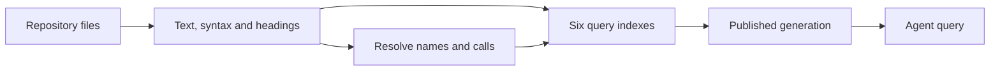

# Codeindex

Coding agents spend time rediscovering a repository on every task. Searching for `send` finds the word in method definitions, unrelated calls, tests and prose. To change one method safely, an agent needs to know which definition a particular call reaches, who else calls it, and which section of the docs describes its behavior.

Codeindex is a local code search and navigation tool for coding agents. Its `cx` CLI answers those questions from a shared repository index. An agent can ask its first question from anywhere inside a Git working tree. The CLI finds the root, builds or refreshes the index under `~/.codeindex`, and answers from one consistent version of the code and docs. Subsequent queries reuse that work. Outside Git, ordinary search scans the requested input and indexed queries keep their results in memory for one invocation.

## What an agent can ask

| Question | Index |
| --- | --- |
| Where is this file? Which paths match a glob? | **Paths** indexes eligible repository paths, including binary files. |
| Where does this exact string or regex match? | **Content** uses trigrams to find candidate files, then verifies the match against their source. |
| Which passage best explains retry behavior? | **Ranked search** uses BM25 to retrieve relevant code and prose chunks with excerpts. |
| Where is a declaration named `send`? | **Symbols** returns declarations with their kind and source location. |
| Which `send` does this call reach? Where is it referenced or called? | **Relationships** connects source locations to semantic identities, with coverage when resolution is incomplete. |
| Which heading contains this Markdown hit? What links to that section? | **Markdown navigation** supplies heading ancestry, exact section or parent text, and backlinks. |

## How it works

Codeindex captures each eligible file version once. Its parsers extract the facts the queries need. The binder resolves names that depend on other files or project settings. Workers share the captured bytes and produce lookup tables in memory. The builder publishes those tables and their source together, so a result, its snippet and its location agree even if the checkout changes during the query.

## Topics

### Working with a checkout

- [Follow a change from its policy to its callers](using-cx.md) walks from ranked documentation to declarations and references.
- [Maintainability measurements](scoring/README.md) explains file scores, their underlying findings and what they establish about test code.

### Engine design

- [First principles](first_principles.md) defines the rule for deciding which work belongs in the engine.
- [Architecture](architecture.md) follows a request from repository capture to a pinned answer.
- [Domain model](domain.md) defines the data structures and their owners.
- [System catalog](boxes/README.md) opens the design for each component.
