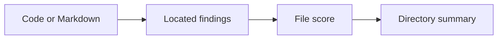

# Maintainability measurements

Use `cx --score` to find a file worth reading and see the code that caused its score. A result can point at the function containing deeply nested decisions, two similar bodies, or a long Markdown section. The finding gives an agent a concrete location to inspect before suggesting a change.

A file has one score derived from its findings. A directory has a line-weighted mean over scorable files, coverage counts and a list of low-scoring files. A directory can therefore look healthy even when one small function deserves attention. Start with the list, then inspect the individual file.

## Topics

### Understanding a result

- [From a finding to a score](interpretation.md) follows a five-parameter function through collection, aggregation and validation.
- [Recognizing test code](test-code.md) explains how to use `cx --score --roles` to distinguish runnable tests, helpers and production code in one file.
